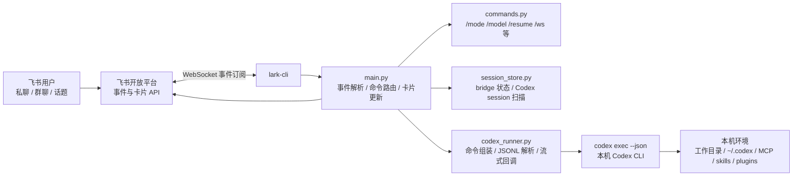

# feishu-codex-bridge

在飞书里操作你本机或服务器上的 Codex CLI。

[English](README_EN.md)

这个 bridge 通过 `lark-cli` WebSocket 接收飞书私聊、群聊和话题消息，在同一台机器上运行 `codex exec --json`，并把文本、工具调用进度和最终结果流式更新到飞书卡片里。

## 来源说明

本项目基于 [`zarazhangrui/feishu-claudecode-bridge`](https://github.com/zarazhangrui/feishu-claudecode-bridge) 改造，原项目使用 MIT License。本仓库已在 [LICENSE](LICENSE) 中保留原始版权声明。

## 安全优先

公开发布默认配置是：

```env
DEFAULT_MODE=plan
```

`plan` 是最保守的模式，适合首次部署和公开项目默认值。确认链路可用后，可以在飞书里切换：

```text
/mode workspace
/mode danger
```

谨慎使用 `danger`：它会把 `--dangerously-bypass-approvals-and-sandbox` 传给 Codex，意味着飞书消息可以触发本机命令执行和文件修改，且不再有交互式确认。只建议在可信的个人机器人和工作区里使用。

## 功能

- 支持飞书私聊、群聊和话题线程。
- 使用飞书卡片流式展示 Codex 文本和工具进度。
- 下载飞书图片消息，并通过 `--image` 转发给 Codex。
- 从 `~/.codex/sessions/**/*.jsonl` 和 `session_index.jsonl` 发现 Codex 会话。
- 每个用户在不同私聊、群聊、话题下都有独立的 session、模型、工作目录和权限模式。
- 用 `/stop` 终止当前 Codex 进程。
- 支持模型、模式、工作空间、MCP、skills、plugins、usage 和 session resume 等命令。

不做：

- Web 管理后台。
- 多用户审批/RBAC 系统。
- 托管云端 Codex runtime。
- 跨机器同步 session。

产品边界见 [docs/PRODUCT_PLAN.md](docs/PRODUCT_PLAN.md)。

## 依赖

本项目默认运行用户已经安装 Codex CLI，并且可以在同一个用户下正常使用。首次安装或排查登录问题，请参考 OpenAI 官方文档：[OpenAI Codex CLI getting started](https://help.openai.com/en/articles/11096431-openai-codex-ligetting-started)。

| 依赖 | 验证命令 |
| --- | --- |
| Python 3.9+ | `python3 --version` |
| Codex CLI | `codex --version`、`codex exec --skip-git-repo-check --json "hello"` |
| lark-cli | `lark-cli --version` |
| 飞书/飞书国际版自建应用 | App ID 和 App Secret |

## 飞书应用配置

1. 在飞书开放平台创建企业自建应用。
2. 添加机器人能力。
3. 导入 [config/feishu_permissions.json](config/feishu_permissions.json) 文件中的权限。
4. 在「事件与回调」中，将「事件」和「回调」都设置为长连接模式。
5. 订阅事件：`im.message.receive_v1`。
6. 启用回调：`card.action.trigger`，用于处理卡片按钮。
7. 保存 App ID 和 App Secret，稍后写入 `.env`。

## 安装 bridge

```bash
git clone https://github.com/your-org/feishu-codex-bridge.git
cd feishu-codex-bridge

python3 -m venv .venv
source .venv/bin/activate
pip install -r requirements.txt

cp .env.example .env
# 编辑 .env，填入 FEISHU_APP_ID 和 FEISHU_APP_SECRET。
```

在运行 bridge 的机器上配置 `lark-cli`：

```bash
set -a
source .env
set +a

printf '%s' "$FEISHU_APP_SECRET" |
  lark-cli config init --app-id "$FEISHU_APP_ID" --app-secret-stdin --brand feishu
```

启动：

```bash
python main.py
```

在飞书里给机器人发送：

```text
/status
```

群聊里需要 @ 机器人。

## 命令

| 命令 | 说明 |
| --- | --- |
| `/new` | 开始新 Codex session |
| `/resume` | 查看可恢复 session |
| `/resume <序号或session_id>` | 恢复指定 session |
| `/stop` | 停止当前任务 |
| `/status` | 查看当前 session、模型、目录和模式 |
| `/model latest` | 切换模型别名或完整模型名 |
| `/mode plan` | 规划模式 |
| `/mode workspace` | 工作区自动模式 |
| `/mode danger` | 全权限自动模式，高风险 |
| `/cd ~/project` | 切换当前工作目录 |
| `/ws save <名称> <路径>` | 保存命名工作空间 |
| `/ws use <名称>` | 将当前私聊、群聊或话题绑定到工作空间 |
| `/mcp` | 查看 Codex MCP servers |
| `/skills` | 查看本机 Codex skills |
| `/plugins` | 查看本机 Codex plugins |
| `/usage` | 查看本机 Codex usage 线索 |
| `/help` | 查看帮助 |

## 架构



运行链路是：飞书事件先进入 `lark-cli`，再交给 `main.py` 解析消息、处理并发锁和更新卡片；普通消息会进入 `codex_runner.py`，由它启动 `codex exec --json` 并解析 JSONL 流；斜杠命令由 `commands.py` 处理；会话、模型、工作目录和权限模式由 `session_store.py` 保存。

## 环境变量

| 变量 | 必填 | 默认值 | 说明 |
| --- | :---: | --- | --- |
| `FEISHU_APP_ID` | 是 | 无 | 飞书应用 App ID |
| `FEISHU_APP_SECRET` | 是 | 无 | 飞书应用 App Secret |
| `DEFAULT_MODEL` | 否 | `gpt-5.5` | 默认 Codex 模型 |
| `DEFAULT_CWD` | 否 | `~` | 默认工作目录 |
| `DEFAULT_MODE` | 否 | `plan` | 默认权限模式 |
| `CODEX_CLI_PATH` | 否 | PATH 中的 `codex` | Codex CLI 路径 |
| `CALLBACK_PORT` | 否 | `9982` | 兼容配置 |
| `STREAM_CHUNK_SIZE` | 否 | `20` | 兼容配置 |

## 部署

推荐部署到 Linux 云服务器，并用 `systemd` 常驻运行。这样不依赖个人电脑开机状态，可以让飞书机器人 7x24 小时在线待命。

部署和冒烟测试请按 [docs/DEPLOY_LINUX.md](docs/DEPLOY_LINUX.md) 操作。开发者本地测试见 [CONTRIBUTING.md](CONTRIBUTING.md)。

## License

[MIT](LICENSE)
