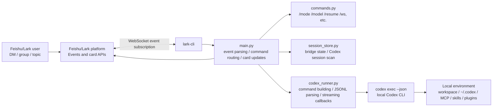

# feishu-codex-bridge

Operate your local Codex CLI from Feishu/Lark.

[中文](README.md)

This bridge receives Feishu private chat, group chat, and topic-thread messages through `lark-cli` WebSocket events, runs `codex exec --json` on the same machine, and streams progress back into Feishu cards.

## Attribution

This project is based on [`zarazhangrui/feishu-claudecode-bridge`](https://github.com/zarazhangrui/feishu-claudecode-bridge), which is licensed under the MIT License. The original copyright notice is preserved in [LICENSE](LICENSE).

## Safety First

The public default is:

```env
DEFAULT_MODE=plan
```

`plan` is the safest mode and is intended for first-time setup and public deployments. You can switch from Feishu:

```text
/mode workspace
/mode danger
```

Be careful with `danger`: it passes `--dangerously-bypass-approvals-and-sandbox` to Codex, so Feishu messages can trigger local command execution and file edits without interactive approval. Only use it in a trusted personal bot and workspace.

## Features

- Feishu private chat, group chat, and topic-thread routing.
- Streaming Feishu card updates for Codex text and tool progress.
- Image message download and forwarding to Codex with `--image`.
- Codex session discovery from `~/.codex/sessions/**/*.jsonl` and `session_index.jsonl`.
- Independent session, model, working directory, and mode per user plus private chat, group, or topic.
- `/stop` for terminating an active Codex process.
- Commands for model, mode, workspace, MCP servers, skills, plugins, usage, and session resume.

Out of scope:

- Web administration UI.
- Multi-user approval/RBAC system.
- Cloud-hosted Codex runtime.
- Cross-machine session synchronization.

See [docs/PRODUCT_PLAN_EN.md](docs/PRODUCT_PLAN_EN.md) for the product contract and boundaries.

## Requirements

This project assumes that the service user already has Codex CLI installed and can use it successfully. For first-time installation or login troubleshooting, see the official OpenAI guide: [OpenAI Codex CLI getting started](https://help.openai.com/en/articles/11096431-openai-codex-ligetting-started).

| Dependency | Check |
| --- | --- |
| Python 3.9+ | `python3 --version` |
| Codex CLI | `codex --version`, `codex exec --skip-git-repo-check --json "hello"` |
| lark-cli | `lark-cli --version` |
| Feishu/Lark custom app | App ID and App Secret |

## Feishu App Setup

1. Create a custom Feishu/Lark app in the developer console.
2. Add the bot capability.
3. Import the permissions from [config/feishu_permissions.json](config/feishu_permissions.json).
4. In "Events and callbacks", set both "Events" and "Callbacks" to long connection mode.
5. Subscribe to the event: `im.message.receive_v1`.
6. Enable the callback: `card.action.trigger`, used for card buttons.
7. Save the App ID and App Secret for `.env`.

## Install The Bridge

```bash
git clone https://github.com/your-org/feishu-codex-bridge.git
cd feishu-codex-bridge

python3 -m venv .venv
source .venv/bin/activate
pip install -r requirements.txt

cp .env.example .env
# Edit .env and fill FEISHU_APP_ID / FEISHU_APP_SECRET.
```

Configure `lark-cli` on the machine running this bridge:

```bash
set -a
source .env
set +a

printf '%s' "$FEISHU_APP_SECRET" |
  lark-cli config init --app-id "$FEISHU_APP_ID" --app-secret-stdin --brand feishu
```

Start the bridge:

```bash
python main.py
```

In Feishu, send the bot:

```text
/status
```

Group chats require mentioning the bot.

## Commands

| Command | Description |
| --- | --- |
| `/new` | Start a new Codex session |
| `/resume` | List resumable sessions |
| `/resume <index-or-session-id>` | Resume a session |
| `/stop` | Stop the active task |
| `/status` | Show current session, model, cwd, and mode |
| `/model latest` | Switch model aliases or use a full model name |
| `/mode plan` | Planning mode |
| `/mode workspace` | Workspace automatic mode |
| `/mode danger` | Full automatic mode, high risk |
| `/cd ~/project` | Change current working directory |
| `/ws save <name> <path>` | Save a named workspace |
| `/ws use <name>` | Bind the current chat/topic to a workspace |
| `/mcp` | List Codex MCP servers |
| `/skills` | List local Codex skills |
| `/plugins` | List local Codex plugins |
| `/usage` | Show local Codex usage hints |
| `/help` | Show help |

## Architecture



The runtime flow is: Feishu/Lark events enter through `lark-cli`, `main.py` parses messages, manages per-chat locks, and updates cards. Normal messages go through `codex_runner.py`, which starts `codex exec --json` and parses the JSONL stream. Slash commands are handled by `commands.py`. Sessions, models, working directories, and permission modes are stored by `session_store.py`.

## Environment Variables

| Variable | Required | Default | Description |
| --- | :---: | --- | --- |
| `FEISHU_APP_ID` | Yes | None | Feishu/Lark app ID |
| `FEISHU_APP_SECRET` | Yes | None | Feishu/Lark app secret |
| `DEFAULT_MODEL` | No | `gpt-5.5` | Default Codex model |
| `DEFAULT_CWD` | No | `~` | Default working directory |
| `DEFAULT_MODE` | No | `plan` | Default permission mode |
| `CODEX_CLI_PATH` | No | `codex` from PATH | Codex CLI path |
| `LOG_CODEX_EVENT_CONTENT` | No | `false` | Set to `true` to log each full Codex JSONL event; may include prompts, tool arguments, and tool output. Enable only for temporary troubleshooting. |
| `CALLBACK_PORT` | No | `9982` | Compatibility setting |
| `STREAM_CHUNK_SIZE` | No | `20` | Compatibility setting |

## Deployment

The recommended deployment target is a Linux cloud server managed by `systemd`. This keeps the Feishu/Lark bot online 24/7 without depending on a personal laptop being awake.

For deployment and smoke testing, follow [docs/DEPLOY_LINUX_EN.md](docs/DEPLOY_LINUX_EN.md). Developer tests are documented in [CONTRIBUTING_EN.md](CONTRIBUTING_EN.md).

## License

[MIT](LICENSE)
